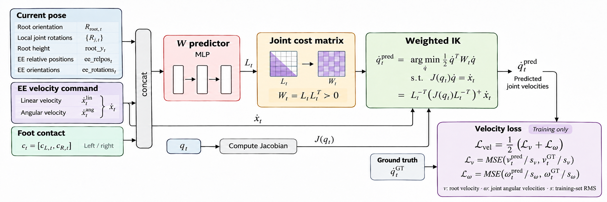

# Synergy-IK

<table width="100%">
  <tr>
    <td align="center" width="50%">
      <br>
      <a href="https://github.com/QjaYo/synergy-ik/issues/3">Jumping rope</a>
    </td>
    <td align="center" width="50%">
      <br>
      <a href="https://github.com/QjaYo/synergy-ik/issues/4">Put down behind</a>
    </td>
  </tr>
  <tr>
    <td align="center" width="50%">
      <br>
      <a href="https://github.com/QjaYo/synergy-ik/issues/5">Padeburee</a>
    </td>
    <td align="center" width="50%">
      <br>
      <a href="https://github.com/QjaYo/synergy-ik/issues/6">Dancing1</a>
    </td>
  </tr>
  <tr>
    <td align="center" width="50%">
      <br>
      <a href="https://github.com/QjaYo/synergy-ik/issues/10">Dancing2</a>
    </td>
    <td align="center" width="50%">
      <br>
      <a href="https://github.com/QjaYo/synergy-ik/issues/8">Run stop</a>
    </td>
  </tr>
</table>

## Project overview

SynergyIK learns state-dependent joint costs from motion data to select
human-like movement while following end-effector (EE) targets.

### 1. Redundant inverse kinematics

At the current pose $q$, the Jacobian maps joint velocities to EE velocities:

```math
J(q)\dot q = \dot x.
```

- $\dot q$: root linear velocity and joint angular velocities.
- $\dot x$: desired EE linear and angular velocities.

There are more joint degrees of freedom than task constraints, so a feasible
task has multiple solutions. IK must choose which joint motion to use.

### 2. Moore-Penrose baseline

The Moore-Penrose solution $\dot q_{\mathrm{MP}} = J(q)^+\dot x$ chooses the
**minimum-norm joint velocity**:

```math
\dot q_{\mathrm{MP}} = \underset{\dot q}{\mathrm{arg\,min}}\;
\frac{1}{2}\dot q^{\mathsf T}\dot q,
\quad\text{subject to}\quad J(q)\dot q = \dot x.
```

**Limitation:** This criterion does not account for human coordination or anatomical
limits and can produce unnatural joint bending.

### 3. Learned joint costs

We train a network on motion data to predict $W$ from the current pose, desired
EE velocities and foot contact. Here, $W$ represents the costs of joint motion,
including coupling between joints. The learned cost guides the choice among IK
solutions toward human-like joint coordination:

```math
\dot q_{\mathrm{pred}} = \underset{\dot q}{\mathrm{arg\,min}}\;
\frac{1}{2}\dot q^{\mathsf T}W\dot q,
\quad\text{subject to}\quad J(q)\dot q = \dot x.
```

**SPD constraint:** We require a strictly positive quadratic cost. The network
predicts a lower-triangular Cholesky factor $L$ with positive diagonal entries,
ensuring that $W$ is symmetric positive definite:

```math
W = LL^{\mathsf T} \succ 0, \qquad L_{ii} > 0.
```

### Architecture



---

## Setup and usage

### Installation

Use Python 3.10. Run commands from the repository root in your Python environment.
Choose the PyTorch CPU/CUDA build for your machine before installing dependencies.

```sh
git submodule update --init -- third_party/fairmotion
python -m pip install -r requirements-training.txt
```

For viewers, also install `requirements-viewer.txt`. They require an OpenGL/GLUT
runtime; mesh rendering additionally needs `usd-core` and the original SOMA
Uniform assets. Optional contact-model setup is in [third_party](third_party/README.md).
Motion data, prepared datasets, checkpoints and local experiments are not included.

### Run

Convert original BVHs, then follow [data preparation](preprocess/training/README.md)
to create `data/preprocessed/`. The [review tool](preprocess/motion_review/README.md)
creates the motion catalog used during preparation.

```sh
python preprocess/canonicalize.py --input-dir path/to/soma_uniform/bvh --output-dir data/canonical_bvh
python source/train.py --dataset data/preprocessed --output experiment/runs/spd_01 --epochs 30 --device cuda --patience 0
python source/evaluate.py --dataset data/preprocessed --checkpoint experiment/runs/spd_01/best.pt --split validation
python source/run.py --bvh-file data/canonical_bvh/DATE/clip.bvh --checkpoint experiment/runs/spd_01/best.pt
```

Replace example paths with your files. The IK viewer compares reference,
Moore-Penrose and weighted motion with matching EE constraints.

```sh
# Resume training; monitor its curves at http://127.0.0.1:6006.
python source/train.py --resume experiment/runs/spd_01/last.pt
python -m tensorboard.main --logdir experiment/runs --host 127.0.0.1 --port 6006

# Inspect a motion or its ankle-contact labels.
python source/visualize_canonicalized_bvh.py --bvh-file data/canonical_bvh/DATE/clip.bvh --no-mesh
python source/visualize_contacts.py --bvh-file data/canonical_bvh/DATE/clip.bvh --no-mesh
```

Additional options are listed by each command's `--help`.

### Tests

With training and viewer dependencies installed:

```sh
python -m unittest discover -s test -v
```

Asset-dependent checks are skipped when their optional data/model files are absent.

---

**Status:** Research is ongoing; the current model uses four EE position/orientation
targets and two ankle-contact inputs, and full-SPD training can still become
ill-conditioned.
